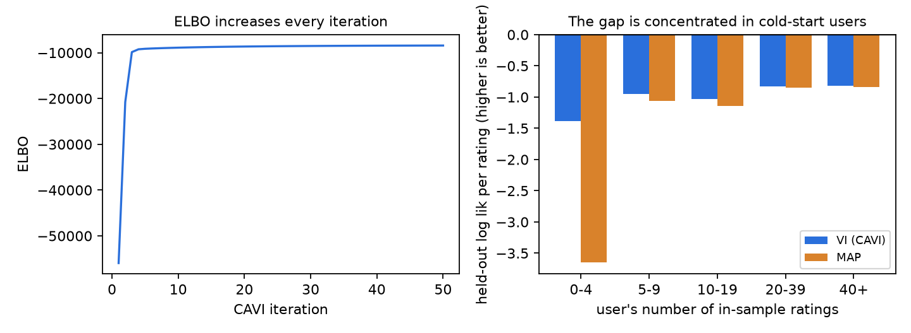

# Uncertainty-aware matrix factorization: when does modeling uncertainty pay off?

Matrix factorization usually commits to a single best vector per user (MAP) and predicts as if that vector were known exactly. For users with only a handful of ratings, that's overconfident. This project implements **mean-field coordinate-ascent variational inference (CAVI) from scratch in NumPy**. CAVI keeps a Gaussian posterior over every user and item vector, and the project measures where that extra uncertainty actually improves predictions.

**Result:** VI beats MAP on held-out predictive log likelihood, and almost all of the gap comes from **cold-start users**. For users with fewer than 5 ratings, MAP's predictions are far too confident.



## Setup

| | |
|---|---|
| Model | `u_i, v_j ~ N(0, I_K)`, `r_ij ~ N(u_iᵀ v_j, σ²)`, K = 3, σ = 0.5 |
| Data | Simulated from the model: 300 users × 200 items, user activity drawn from Beta(0.7, 4), so some users rate only a few items |
| Split | 20% of observed ratings held out (7,266 train / 1,880 test for seed 1) |
| VI | Mean-field Gaussian `q(u_i) q(v_j)`, closed-form CAVI updates, 50 iterations |
| Baseline | MAP by coordinate ascent (each block update is an exact ridge regression), same initialization |
| Metric | Average held-out predictive log likelihood per rating. VI uses `N(μ_iᵀν_j, σ² + Var_q[u_iᵀv_j])`; MAP uses the plug-in `N(û_iᵀv̂_j, σ²)` |

Simulated data with known ground truth isolates the question being asked (does representing parameter uncertainty help?) from any mismatch between the model and real data.

## Results

Seed 1:

| User's in-sample ratings | Held-out ratings | VI | MAP |
|---|---:|---:|---:|
| 0–4 | 31 | **−1.380** | −3.650 |
| 5–9 | 93 | **−0.953** | −1.064 |
| 10–19 | 166 | **−1.031** | −1.142 |
| 20–39 | 572 | **−0.830** | −0.850 |
| 40+ | 1,018 | **−0.815** | −0.840 |
| **All** | 1,880 | **−0.855** | −0.927 |

Robustness over 10 random seeds (VI minus MAP, mean ± sd):

- All held-out ratings: **+0.075 ± 0.041**, VI better in 10/10 seeds
- Users with < 5 ratings: **+2.19 ± 1.37**, VI better in 10/10 seeds

## Validation

- **Correctness of the updates:** the ELBO is computed in closed form after every iteration, and the code asserts that it never decreases (it rises monotonically from −55,946 to −8,434).
- **Out-of-sample evaluation only:** all comparisons use held-out ratings that neither method saw.
- **Breakdown by user activity:** the per-bin results show where the gain comes from, not just that there is one.
- **Repeated over seeds:** the direction of the effect holds in every one of 10 seeds. The cold-start bin is small (about 30 ratings per seed), so its magnitude varies more than its sign.

## Takeaway

When a model's parameters are poorly determined, the cost of ignoring that uncertainty lands on exactly the cases with the least data: new users, new merchants, new businesses. A posterior that widens its predictions there is better calibrated. Calibration matters whenever decisions (credit limits, fraud flags, recommendations) are made on thin data.

One caveat: mean-field VI is itself known to *under*estimate posterior variance. My ongoing research at Columbia measures how much that residual overconfidence costs in downstream decisions.

## Run it

```bash
python -m venv .venv && .venv/bin/pip install -r requirements.txt
.venv/bin/python mf_cavi.py              # seed 1, prints the tables, writes figs/results.png
.venv/bin/python mf_cavi.py --seeds 10   # adds the multi-seed robustness check
```

Runs in a few seconds on a laptop CPU.

---
Rahul Prajapat · MS CS (ML), Columbia University
